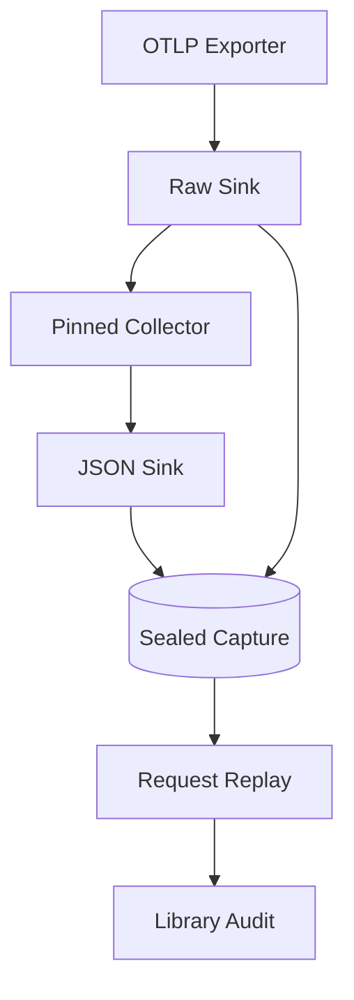

<h3>PR Summary by Qodo</h3>

Build a byte-preserving OTLP capture, replay, and audit zoo

<code>✨ Enhancement</code> <code>🧪 Tests</code> <code>📝 Documentation</code> <code>⚙️ Configuration changes</code> <code>🕐 40+ Minutes</code>

AI Description

<dl>
<dd>
 

><pre>
>• Record exporter requests before forwarding them to a pinned Collector for adjacent OTLP/JSON
>  captures.
>• Seal and verify captures, then replay their recorded requests without interpreting payloads.
>• Audit real captures against pinned libraries and preserve reproducible findings, tests, and
>  operator guidance.
></pre>

</dd>
</dl>

Diagram

<dl>
<dd>

 

</dd>
</dl>

High-Level Assessment

<dl>
<dd>

 

>The following are alternative approaches to this PR:

<b>1. Wire-level TCP proxy</b>

<dl>
<dd>

- ➕ Could preserve transport framing and support requests beyond the current Content-Length-based HTTP sink.
- ➖ Substantially complicates request accounting, Collector forwarding, and the documented OTLP/HTTP capture contract.

</dd>
</dl>

>**Recommendation:** Keep the application-level sink and pinned stock Collector for the stated OTLP/HTTP scope: they separate the authoritative request record from optional re-encoding. Consider a wire-level proxy only if preserving HTTP framing or supporting chunked uploads becomes a requirement.

</dd>
</dl>

 Files changed (112) <code> +23716 / -124 </code> 

<dl>
<dd>

 

Enhancement (9) <code> +4716 / -25 </code>

<dl>
<dd>

__init__.py<code>Adjust package metadata</code> <code>+3/-2</code>

 

>Adjust package metadata
>
><pre>
>• Aligns package initialization with the completed zoo implementation.
></pre>
>
><a href='https://github.com/SigorMatt/spanweave-zoo/pull/1/files#diff-bdd40de5d457580564ec46da65a931031ec28a8454e1bcbfec12bde134b28543'>spanweave_zoo/__init__.py</a>

audit.py<code>Audit captures against pinned libraries</code> <code>+1052/-0</code>

 

>Audit captures against pinned libraries
>
><pre>
>• Runs raw and JSON replay through spanweave-live, compares live and batch graphs, inspects diagnostics, and smokes agentgolden signatures. Writes owner-attributed findings without modifying payloads.
></pre>
>
><a href='https://github.com/SigorMatt/spanweave-zoo/pull/1/files#diff-47581901d6484d16a813e3b080e9729fe742aeef4e8841ae6fa74721580ea75d'>spanweave_zoo/audit.py</a>

capture.py<code>Coordinate two sinks and the Collector</code> <code>+489/-0</code>

 

>Coordinate two sinks and the Collector
>
><pre>
>• Starts the tee before creating a run directory, journals capture outcomes, and orders shutdown so Collector output can flush.
></pre>
>
><a href='https://github.com/SigorMatt/spanweave-zoo/pull/1/files#diff-f6dbffc20545c9f79c9c5419f0d09e34c29f9e19f8e9fd319ab370b7444a59a0'>spanweave_zoo/capture.py</a>

cli.py<code>Expose the complete zoo command line</code> <code>+659/-23</code>

 

>Expose the complete zoo command line
>
><pre>
>• Adds sink, capture, replay, verification, and lazily imported audit commands with explicit refusal and exit behavior.
></pre>
>
><a href='https://github.com/SigorMatt/spanweave-zoo/pull/1/files#diff-28176bf1a87cc5cd620bd3d1b421175c745c4520f167ffa6e2dfb50544ad209a'>spanweave_zoo/cli.py</a>

collector.py<code>Manage the pinned Collector process</code> <code>+425/-0</code>

 

>Manage the pinned Collector process
>
><pre>
>• Validates the binary version, confirms readiness against its own log and listener, isolates signals, and captures process output.
></pre>
>
><a href='https://github.com/SigorMatt/spanweave-zoo/pull/1/files#diff-5d42e852ced9e74f1ddb761245b03b71b585868beb698d5e1d7c948588ca2344'>spanweave_zoo/collector.py</a>

forward.py<code>Forward recorded request octets</code> <code>+232/-0</code>

 

>Forward recorded request octets
>
><pre>
>• Provides outbound socket operations that preserve bodies and request heads while replacing Host and removing connection-specific fields for the tee.
></pre>
>
><a href='https://github.com/SigorMatt/spanweave-zoo/pull/1/files#diff-caca4e273e005d0743185579e81c1786ce61a44d764c0d7ad3a3e0d3fe6407ca'>spanweave_zoo/forward.py</a>

manifest.py<code>Journal, seal, and verify captures</code> <code>+935/-0</code>

 

>Journal, seal, and verify captures
>
><pre>
>• Assembles one end-of-run manifest covering all capture files and checks hashes, membership, completion, problems, and the manifest&#x27;s own seal.
></pre>
>
><a href='https://github.com/SigorMatt/spanweave-zoo/pull/1/files#diff-91e4576c370659513cd85336bc123e9621c58751a5bf32b7a60c9d64bd2f28f1'>spanweave_zoo/manifest.py</a>

replay.py<code>Replay raw or JSON capture requests</code> <code>+335/-0</code>

 

>Replay raw or JSON capture requests
>
><pre>
>• Resends stored body and request-head octets with Host substituted, supports optional receipt timing, and reports unsendable requests.
></pre>
>
><a href='https://github.com/SigorMatt/spanweave-zoo/pull/1/files#diff-9ca2a1a669bc147df21a9958b7b0fc308e4010530a6d90aaee22498ebce263ed'>spanweave_zoo/replay.py</a>

sink.py<code>Record exporter POSTs without parsing bodies</code> <code>+586/-0</code>

 

>Record exporter POSTs without parsing bodies
>
><pre>
>• Writes received body bytes, original request-head octets, and a CRLF-derived header view before answering or forwarding. Also records rejected paths.
></pre>
>
><a href='https://github.com/SigorMatt/spanweave-zoo/pull/1/files#diff-3f59dfb8e8793662fc800e936294e5650b61be82371902f71129898097124517'>spanweave_zoo/sink.py</a>

</dd>
</dl>

Documentation (37) <code> +11026 / -63 </code>

<dl>
<dd>

CHANGELOG.md<code>Record series-one implementation history</code> <code>+787/-1</code>

 

>Record series-one implementation history
>
><pre>
>• Documents the staged capture, verification, replay, audit, and review changes.
></pre>
>
><a href='https://github.com/SigorMatt/spanweave-zoo/pull/1/files#diff-06572a96a58dc510037d5efa622f9bec8519bc1beab13c9f251e97e657a9d4ed'>CHANGELOG.md</a>

CLAUDE.md<code>Clarify repository operating rules</code> <code>+12/-8</code>

 

>Clarify repository operating rules
>
><pre>
>• Adjusts contributor guidance to reflect the completed series and its standing invariants.
></pre>
>
><a href='https://github.com/SigorMatt/spanweave-zoo/pull/1/files#diff-6ebdb617a8104a7756d0cf36578ab01103dc9f07e4dc6feb751296b9c402faf7'>CLAUDE.md</a>

CONTRIBUTING.md<code>Revise contributor workflow guidance</code> <code>+3/-2</code>

 

>Revise contributor workflow guidance
>
><pre>
>• Updates the contribution instructions for the expanded repository workflow.
></pre>
>
><a href='https://github.com/SigorMatt/spanweave-zoo/pull/1/files#diff-eca12c0a30e25b4b46522ebf89465a03ba72a03f540796c979137931d8f92055'>CONTRIBUTING.md</a>

LICENSE<code>Add MIT license</code> <code>+21/-0</code>

 

>Add MIT license
>
><pre>
>• Adds the license referenced by the package metadata.
></pre>
>
><a href='https://github.com/SigorMatt/spanweave-zoo/pull/1/files#diff-c693279643b8cd5d248172d9c22cb7cf4ed163a3c98c8a3f69c2717edd3eacb7'>LICENSE</a>

OPEN_QUESTIONS.md<code>Preserve resolved design decisions</code> <code>+302/-0</code>

 

>Preserve resolved design decisions
>
><pre>
>• Records options and decisions governing capture timing, request fidelity, replay, and audit behavior.
></pre>
>
><a href='https://github.com/SigorMatt/spanweave-zoo/pull/1/files#diff-80c8c3990ef48f9c381aaddbf549e2394c047ffd1b8a72b07c603bd7771b665e'>OPEN_QUESTIONS.md</a>

PROBES.md<code>Consolidate library-owned reproductions</code> <code>+168/-0</code>

 

>Consolidate library-owned reproductions
>
><pre>
>• Turns the two committed audit reports into commands and observations for the owning libraries&#x27; next work.
></pre>
>
><a href='https://github.com/SigorMatt/spanweave-zoo/pull/1/files#diff-4f86ca652d481ed94300e39fb37af0bd2c7ae4828b858ad07a01508d224563c0'>PROBES.md</a>

README.md<code>Document the complete zoo workflow</code> <code>+364/-15</code>

 

>Document the complete zoo workflow
>
><pre>
>• Explains capture, Collector setup, verification, replay, audit, and reproducible commands.
></pre>
>
><a href='https://github.com/SigorMatt/spanweave-zoo/pull/1/files#diff-b335630551682c19a781afebcf4d07bf978fb1f8ac04c6bf87428ed5106870f5'>README.md</a>

SPEC.md<code>Specify capture and audit contracts</code> <code>+1725/-37</code>

 

>Specify capture and audit contracts
>
><pre>
>• Defines normative behavior for recorded heads, tee lifecycle, manifest sealing, verification, replay, and audit.
></pre>
>
><a href='https://github.com/SigorMatt/spanweave-zoo/pull/1/files#diff-7426c9e3a694ca6015df5f98637912975f2edea23270203ee89a8bdeed246ee0'>SPEC.md</a>

TASKS.md<code>Archive series-one task registry</code> <code>+606/-0</code>

 

>Archive series-one task registry
>
><pre>
>• Preserves completed batch references, decisions, and handoff notes after the execution plan closes.
></pre>
>
><a href='https://github.com/SigorMatt/spanweave-zoo/pull/1/files#diff-66ee26543c5fa02b0db4d04d72834581c54f595e095f50d3a5f86a1d6bdb63b0'>TASKS.md</a>

z4-2026-10-12-real.md<code>Commit real-run audit findings</code> <code>+218/-0</code>

 

>Commit real-run audit findings
>
><pre>
>• Records five audit steps, pinned versions, and owner-attributed findings for the real Z4 capture.
></pre>
>
><a href='https://github.com/SigorMatt/spanweave-zoo/pull/1/files#diff-8010b58eacb8fd302adbc3b489aa0f1f945a75ab0262c089ebba554ac84b5de5'>audit/z4-2026-10-12-real.md</a>

z4-2026-10-12-recorded.md<code>Commit recorded-run audit findings</code> <code>+215/-0</code>

 

>Commit recorded-run audit findings
>
><pre>
>• Records the same audit method and reproducible findings for Z4&#x27;s recorded run.
></pre>
>
><a href='https://github.com/SigorMatt/spanweave-zoo/pull/1/files#diff-11d563099b5e1b77840bb20d13f12023e64b3d0a7a2c3465acd8110f9cf056d5'>audit/z4-2026-10-12-recorded.md</a>

section-a0a.md<code>Archive run-two A0a review</code> <code>+94/-0</code>

 

>Archive run-two A0a review
>
><pre>
>• Preserves the review section and its evidence for that batch.
></pre>
>
><a href='https://github.com/SigorMatt/spanweave-zoo/pull/1/files#diff-be1e90e34d6182b22c8cf1e3e6ed15b223624142bc892f0e1dd312e322793e4f'>reviews/REVIEW-2026-10-10-run2-sections/section-a0a.md</a>

section-a0b.md<code>Archive run-two A0b review</code> <code>+218/-0</code>

 

>Archive run-two A0b review
>
><pre>
>• Preserves the review section for the Collector CI work.
></pre>
>
><a href='https://github.com/SigorMatt/spanweave-zoo/pull/1/files#diff-97873cda3f67ea284c5eea4d53aeb6db854b5996a71a72dc8edc049fe16f054c'>reviews/REVIEW-2026-10-10-run2-sections/section-a0b.md</a>

section-a3a.md<code>Archive run-two A3a review</code> <code>+305/-0</code>

 

>Archive run-two A3a review
>
><pre>
>• Retains batch-specific capture-lifecycle review evidence.
></pre>
>
><a href='https://github.com/SigorMatt/spanweave-zoo/pull/1/files#diff-455900ddb9c287a67eca42527b5f12f9689c3d4acece2b518e79e34f2f074d8a'>reviews/REVIEW-2026-10-10-run2-sections/section-a3a.md</a>

section-a3b.md<code>Archive run-two A3b review</code> <code>+291/-0</code>

 

>Archive run-two A3b review
>
><pre>
>• Retains review evidence concerning journal and manifest changes.
></pre>
>
><a href='https://github.com/SigorMatt/spanweave-zoo/pull/1/files#diff-47a4fc12aef69bc39ac4c8b06b2975743ed528f0f59c768975e248d0a959ba07'>reviews/REVIEW-2026-10-10-run2-sections/section-a3b.md</a>

section-a3c.md<code>Archive run-two A3c review</code> <code>+258/-0</code>

 

>Archive run-two A3c review
>
><pre>
>• Retains review evidence concerning captured request heads.
></pre>
>
><a href='https://github.com/SigorMatt/spanweave-zoo/pull/1/files#diff-7cd89827ebe65b436b6ea393d84d24c1e36f0fca88b385f9d2c1880d374b4143'>reviews/REVIEW-2026-10-10-run2-sections/section-a3c.md</a>

section-a3d.md<code>Archive run-two A3d review</code> <code>+240/-0</code>

 

>Archive run-two A3d review
>
><pre>
>• Retains review evidence for verification and fixture gates.
></pre>
>
><a href='https://github.com/SigorMatt/spanweave-zoo/pull/1/files#diff-c5908be0fa628989de227176484496a667650b9ac1ec000438ae42d256e60a9f'>reviews/REVIEW-2026-10-10-run2-sections/section-a3d.md</a>

section-a4.md<code>Archive run-two A4 review</code> <code>+163/-0</code>

 

>Archive run-two A4 review
>
><pre>
>• Retains the replay batch&#x27;s review section.
></pre>
>
><a href='https://github.com/SigorMatt/spanweave-zoo/pull/1/files#diff-d25e2b1e2191bb6a1a43caff990ce7d1a12e9deb2775ee80edb41bd9dd655b18'>reviews/REVIEW-2026-10-10-run2-sections/section-a4.md</a>

section-operator.md<code>Archive run-two operator review</code> <code>+113/-0</code>

 

>Archive run-two operator review
>
><pre>
>• Preserves operator-facing review observations and follow-ups.
></pre>
>
><a href='https://github.com/SigorMatt/spanweave-zoo/pull/1/files#diff-64bfaf51d43cd54a7d6c4b04ac12349df908a08e5c6fc0f6c514797a6f356738'>reviews/REVIEW-2026-10-10-run2-sections/section-operator.md</a>

section-plan.md<code>Archive run-two plan review</code> <code>+225/-0</code>

 

>Archive run-two plan review
>
><pre>
>• Preserves execution-plan review observations.
></pre>
>
><a href='https://github.com/SigorMatt/spanweave-zoo/pull/1/files#diff-569f50dde86eadc9e7f21d19d9584b845bc334baaf6e291ac257fdd5e4c1ce82'>reviews/REVIEW-2026-10-10-run2-sections/section-plan.md</a>

REVIEW-2026-10-10-run2.md<code>Archive assembled run-two review</code> <code>+398/-0</code>

 

>Archive assembled run-two review
>
><pre>
>• Preserves the consolidated second review and its findings.
></pre>
>
><a href='https://github.com/SigorMatt/spanweave-zoo/pull/1/files#diff-53fc23d0dcfd11d21a92897fed8629042fe9bf9764f872b51c047a15246930a6'>reviews/REVIEW-2026-10-10-run2.md</a>

section-a0.md<code>Archive first-review A0 section</code> <code>+258/-0</code>

 

>Archive first-review A0 section
>
><pre>
>• Retains the initial skeleton batch&#x27;s review evidence.
></pre>
>
><a href='https://github.com/SigorMatt/spanweave-zoo/pull/1/files#diff-110bc09af213e49cdc6a7f6e02d941de638086883262d55bb65264377bd9e66f'>reviews/REVIEW-2026-10-10-sections/section-a0.md</a>

section-a1.md<code>Archive first-review A1 section</code> <code>+418/-0</code>

 

>Archive first-review A1 section
>
><pre>
>• Retains the sink batch&#x27;s review evidence.
></pre>
>
><a href='https://github.com/SigorMatt/spanweave-zoo/pull/1/files#diff-3f7bba8c4602dddb43635201a3706f96f6ddb05a11abf06852697e231f477af1'>reviews/REVIEW-2026-10-10-sections/section-a1.md</a>

section-a2.md<code>Archive first-review A2 section</code> <code>+454/-0</code>

 

>Archive first-review A2 section
>
><pre>
>• Retains the Collector tee batch&#x27;s review evidence.
></pre>
>
><a href='https://github.com/SigorMatt/spanweave-zoo/pull/1/files#diff-1f32c8fc94900390724edd791325687ae4b82e461fae1a3e20ff636481e4ac47'>reviews/REVIEW-2026-10-10-sections/section-a2.md</a>

section-a3.md<code>Archive first-review A3 section</code> <code>+395/-0</code>

 

>Archive first-review A3 section
>
><pre>
>• Retains the manifest batch&#x27;s review evidence.
></pre>
>
><a href='https://github.com/SigorMatt/spanweave-zoo/pull/1/files#diff-a3657aeb62ef5a58605a06b02225a03b013ab5d7ae467ec018c2d6d981f77654'>reviews/REVIEW-2026-10-10-sections/section-a3.md</a>

section-operator.md<code>Archive first-review operator section</code> <code>+361/-0</code>

 

>Archive first-review operator section
>
><pre>
>• Preserves operator-facing findings from the first review.
></pre>
>
><a href='https://github.com/SigorMatt/spanweave-zoo/pull/1/files#diff-3c3cd9a12e8b50a166e0a8e792b83f49dcffc953b9061c7fc493ce7f86cfe91e'>reviews/REVIEW-2026-10-10-sections/section-operator.md</a>

section-plan.md<code>Archive first-review plan section</code> <code>+609/-0</code>

 

>Archive first-review plan section
>
><pre>
>• Preserves the first review&#x27;s execution-plan findings.
></pre>
>
><a href='https://github.com/SigorMatt/spanweave-zoo/pull/1/files#diff-2c8ca9db4d0655ceec14f3ef75da5166e1cd6a0f37e5f70a70df47d8575e4659'>reviews/REVIEW-2026-10-10-sections/section-plan.md</a>

REVIEW-2026-10-10.md<code>Archive assembled first review</code> <code>+432/-0</code>

 

>Archive assembled first review
>
><pre>
>• Preserves the consolidated initial review record.
></pre>
>
><a href='https://github.com/SigorMatt/spanweave-zoo/pull/1/files#diff-2adb463eea8dd8aac0d92548b7d2f8685f7924fffc3f883e5ba5a0bdb3ae015f'>reviews/REVIEW-2026-10-10.md</a>

section-a0c.md<code>Archive A0c follow-up review</code> <code>+104/-0</code>

 

>Archive A0c follow-up review
>
><pre>
>• Retains review evidence for README command rehearsal.
></pre>
>
><a href='https://github.com/SigorMatt/spanweave-zoo/pull/1/files#diff-c0bb17889eb7b47660d281c76f76d46820578b9975787007890323ec2d20f898'>reviews/REVIEW-2026-10-11-sections/section-a0c.md</a>

section-a3e.md<code>Archive A3e follow-up review</code> <code>+233/-0</code>

 

>Archive A3e follow-up review
>
><pre>
>• Retains review evidence for capture shutdown behavior.
></pre>
>
><a href='https://github.com/SigorMatt/spanweave-zoo/pull/1/files#diff-fe72ff48b2ff8158552eb6cd8b61f393e885d3689e2c7f88b6efa1f2053aa0cd'>reviews/REVIEW-2026-10-11-sections/section-a3e.md</a>

section-a3f.md<code>Archive A3f follow-up review</code> <code>+171/-0</code>

 

>Archive A3f follow-up review
>
><pre>
>• Retains review evidence for manifest sealing and head derivation.
></pre>
>
><a href='https://github.com/SigorMatt/spanweave-zoo/pull/1/files#diff-16c8b2fda0e5d7430fefa0ced7b492f67a81ee4afb67ae0b386332143270cc60'>reviews/REVIEW-2026-10-11-sections/section-a3f.md</a>

section-a4a.md<code>Archive A4a follow-up review</code> <code>+112/-0</code>

 

>Archive A4a follow-up review
>
><pre>
>• Retains review evidence for captured-head replay.
></pre>
>
><a href='https://github.com/SigorMatt/spanweave-zoo/pull/1/files#diff-e2b88588b8892f61d537a4ed5d2eea88f951fc41fee2808f9a2465f9aed7c45e'>reviews/REVIEW-2026-10-11-sections/section-a4a.md</a>

section-operator.md<code>Archive follow-up operator review</code> <code>+81/-0</code>

 

>Archive follow-up operator review
>
><pre>
>• Preserves operator observations from the October 11 review.
></pre>
>
><a href='https://github.com/SigorMatt/spanweave-zoo/pull/1/files#diff-44f6c5cdb79f192529b9ae9a6cee7cf0b98292972c2cd41f9f176ac72426f20c'>reviews/REVIEW-2026-10-11-sections/section-operator.md</a>

section-plan.md<code>Archive follow-up plan review</code> <code>+89/-0</code>

 

>Archive follow-up plan review
>
><pre>
>• Preserves plan observations from the October 11 review.
></pre>
>
><a href='https://github.com/SigorMatt/spanweave-zoo/pull/1/files#diff-4f499e9d2b015aaf96165527195820a2f0517f2bd87183a4cbbc302b7ae6e27e'>reviews/REVIEW-2026-10-11-sections/section-plan.md</a>

REVIEW-2026-10-11.md<code>Archive assembled follow-up review</code> <code>+249/-0</code>

 

>Archive assembled follow-up review
>
><pre>
>• Preserves the consolidated October 11 review findings.
></pre>
>
><a href='https://github.com/SigorMatt/spanweave-zoo/pull/1/files#diff-04dda4efa30cefd8f27c2beedf2d698a37ec8264b6b49e3a0ec6458ba9dbaaeb'>reviews/REVIEW-2026-10-11.md</a>

REVIEW-2026-10-12.md<code>Archive scoped series-close review</code> <code>+309/-0</code>

 

>Archive scoped series-close review
>
><pre>
>• Records cold-review findings, reproduction checks, and CI status at series close.
></pre>
>
><a href='https://github.com/SigorMatt/spanweave-zoo/pull/1/files#diff-a4cd22d4e41ce3e3599263caf3719f52266e125147b4ea50fd4999e388738f52'>reviews/REVIEW-2026-10-12.md</a>

SHA256SUMS<code>Hash archived review documents</code> <code>+25/-0</code>

 

>Hash archived review documents
>
><pre>
>• Provides digests for checking that the committed review archive remains unchanged.
></pre>
>
><a href='https://github.com/SigorMatt/spanweave-zoo/pull/1/files#diff-8a858aa09aa2fefe9a9fd8ec3c5d1faa789b042161af8cf31a368fd534dca439'>reviews/SHA256SUMS</a>

</dd>
</dl>

Other (66) <code> +7974 / -36 </code>

<dl>
<dd>

.gitattributes<code>Mark capture artifacts for faithful storage</code> <code>+13/-0</code>

 

>Mark capture artifacts for faithful storage
>
><pre>
>• Adds repository attributes for committed capture artifacts.
></pre>
>
><a href='https://github.com/SigorMatt/spanweave-zoo/pull/1/files#diff-618cd5b83d62060ba3d027e314a21ceaf75d36067ff820db126642944145393e'>.gitattributes</a>

ci.yml<code>Add Collector and audit CI jobs</code> <code>+60/-0</code>

 

>Add Collector and audit CI jobs
>
><pre>
>• Adds dedicated jobs that install their optional prerequisites and fail if selected integration tests skip.
></pre>
>
><a href='https://github.com/SigorMatt/spanweave-zoo/pull/1/files#diff-b803fcb7f17ed9235f1e5cb1fcd2f5d3b2838429d4368ae4c57ce4436577f03f'>.github/workflows/ci.yml</a>

.gitignore<code>Ignore fetched Collector artifacts</code> <code>+3/-0</code>

 

>Ignore fetched Collector artifacts
>
><pre>
>• Excludes downloaded Collector binaries and caches from version control.
></pre>
>
><a href='https://github.com/SigorMatt/spanweave-zoo/pull/1/files#diff-bc37d034bad564583790a46f19d807abfe519c5671395fd494d8cce506c42947'>.gitignore</a>

Makefile<code>Add capture and integration-check targets</code> <code>+53/-6</code>

 

>Add capture and integration-check targets
>
><pre>
>• Makes verification check a committed fixture and adds Collector fetching plus non-skipping Collector and audit checks.
></pre>
>
><a href='https://github.com/SigorMatt/spanweave-zoo/pull/1/files#diff-76ed074a9305c04054cdebb9e9aad2d818052b07091de1f20cad0bbac34ffb52'>Makefile</a>

MANIFEST.json<code>Seal the real Z4 capture</code> <code>+120/-0</code>

 

>Seal the real Z4 capture
>
><pre>
>• Lists captured bodies, ancillary files, provenance, forwarding outcomes, and integrity claims.
></pre>
>
><a href='https://github.com/SigorMatt/spanweave-zoo/pull/1/files#diff-4d90509d6392889a6f9413c28725b29efa163473b5741bc0b081f8af239cf609'>captures/z4/2026-10-12-real/MANIFEST.json</a>

bodies.jsonl<code>Journal real-run bodies</code> <code>+4/-0</code>

 

>Journal real-run bodies
>
><pre>
>• Preserves per-body recording entries used to assemble the real-run manifest.
></pre>
>
><a href='https://github.com/SigorMatt/spanweave-zoo/pull/1/files#diff-e2cd645511ff8680a4830488a321970f3a6ac66ceee0e5842d355d66a610b6dd'>captures/z4/2026-10-12-real/bodies.jsonl</a>

collector.log<code>Preserve real-run Collector output</code> <code>+11/-0</code>

 

>Preserve real-run Collector output
>
><pre>
>• Retains the Collector&#x27;s startup and processing log as hashed capture evidence.
></pre>
>
><a href='https://github.com/SigorMatt/spanweave-zoo/pull/1/files#diff-466da16909902901193e2cec0a6339a3bb049684877bef04843c47ed6867618d'>captures/z4/2026-10-12-real/collector.log</a>

forwards.jsonl<code>Journal real-run forwarding</code> <code>+2/-0</code>

 

>Journal real-run forwarding
>
><pre>
>• Records attempted deliveries from the raw sink to the Collector.
></pre>
>
><a href='https://github.com/SigorMatt/spanweave-zoo/pull/1/files#diff-65784011514a82bb3674d23a1f997e7fc1a66bdd7ea1c3ce3d0467f4174c149e'>captures/z4/2026-10-12-real/forwards.jsonl</a>

0001.headers.json<code>Record first real JSON request headers</code> <code>+28/-0</code>

 

>Record first real JSON request headers
>
><pre>
>• Stores the derived header representation for the first Collector export.
></pre>
>
><a href='https://github.com/SigorMatt/spanweave-zoo/pull/1/files#diff-a4a0c3877db625353eeb8249121fbc04cbb09cba16f6644cf93d5565cf75a4f4'>captures/z4/2026-10-12-real/json/0001.headers.json</a>

0001.headers.raw<code>Record first real JSON request head</code> <code>+7/-0</code>

 

>Record first real JSON request head
>
><pre>
>• Preserves the first Collector export&#x27;s request-head octets.
></pre>
>
><a href='https://github.com/SigorMatt/spanweave-zoo/pull/1/files#diff-09f213178e76c0f648296fb17dfe85a088f03cc0efd64f3b6ede452fa5a22101'>captures/z4/2026-10-12-real/json/0001.headers.raw</a>

0001.json<code>Capture first real OTLP/JSON export</code> <code>+1/-0</code>

 

>Capture first real OTLP/JSON export
>
><pre>
>• Stores the Collector&#x27;s first JSON re-encoding for the real run.
></pre>
>
><a href='https://github.com/SigorMatt/spanweave-zoo/pull/1/files#diff-3e67577116907371a97ca3268644ef93791b2c3e58b16dc5e2b72cbedb5be872'>captures/z4/2026-10-12-real/json/0001.json</a>

0002.headers.json<code>Record second real JSON request headers</code> <code>+28/-0</code>

 

>Record second real JSON request headers
>
><pre>
>• Stores the derived header representation for the second Collector export.
></pre>
>
><a href='https://github.com/SigorMatt/spanweave-zoo/pull/1/files#diff-6f17d9366c10c700a6b8d7c02203bb08073d726387453f8fc82b143978d53691'>captures/z4/2026-10-12-real/json/0002.headers.json</a>

0002.headers.raw<code>Record second real JSON request head</code> <code>+7/-0</code>

 

>Record second real JSON request head
>
><pre>
>• Preserves the second Collector export&#x27;s request-head octets.
></pre>
>
><a href='https://github.com/SigorMatt/spanweave-zoo/pull/1/files#diff-e86f182630e505cbe9cf69fe62d16b3746df370d8e0bfc1bc66a77b08af277cf'>captures/z4/2026-10-12-real/json/0002.headers.raw</a>

0002.json<code>Capture second real OTLP/JSON export</code> <code>+1/-0</code>

 

>Capture second real OTLP/JSON export
>
><pre>
>• Stores the Collector&#x27;s second JSON re-encoding for the real run.
></pre>
>
><a href='https://github.com/SigorMatt/spanweave-zoo/pull/1/files#diff-26a9aa7d16a321ae887b8b6458f8145399d2a3bec13402a67474125751e43462'>captures/z4/2026-10-12-real/json/0002.json</a>

0001.body<code>Preserve first real exporter body</code> <code>+0/-0</code>

 

>Preserve first real exporter body
>
><pre>
>• Commits the original protobuf request body as capture evidence.
></pre>
>
><a href='https://github.com/SigorMatt/spanweave-zoo/pull/1/files#diff-fc0f1586f7546b5f0a4dabe5ef29662c1fbc3e87cb4fffa585fedfc1609e5234'>captures/z4/2026-10-12-real/raw/0001.body</a>

0001.headers.json<code>Describe first real exporter head</code> <code>+36/-0</code>

 

>Describe first real exporter head
>
><pre>
>• Stores the CRLF-derived representation of the first recorded request head.
></pre>
>
><a href='https://github.com/SigorMatt/spanweave-zoo/pull/1/files#diff-13f39d65c0d3e584b79d548abaf87a8afe84ad0a8deb6ee0c3db9fde32672992'>captures/z4/2026-10-12-real/raw/0001.headers.json</a>

0001.headers.raw<code>Preserve first real exporter head</code> <code>+9/-0</code>

 

>Preserve first real exporter head
>
><pre>
>• Stores the first request&#x27;s original head octets for faithful replay.
></pre>
>
><a href='https://github.com/SigorMatt/spanweave-zoo/pull/1/files#diff-52bbefe18a0809df75211356df3ed119e52a068c3be3280ed0b79dd11a73b487'>captures/z4/2026-10-12-real/raw/0001.headers.raw</a>

0002.body<code>Preserve second real exporter body</code> <code>+0/-0</code>

 

>Preserve second real exporter body
>
><pre>
>• Commits the second original protobuf request body as capture evidence.
></pre>
>
><a href='https://github.com/SigorMatt/spanweave-zoo/pull/1/files#diff-02ffd6f4091c8b945ef3279b602422b0ad4eb628b88b38c9769737a79091ed5c'>captures/z4/2026-10-12-real/raw/0002.body</a>

0002.headers.json<code>Describe second real exporter head</code> <code>+36/-0</code>

 

>Describe second real exporter head
>
><pre>
>• Stores the CRLF-derived representation of the second recorded request head.
></pre>
>
><a href='https://github.com/SigorMatt/spanweave-zoo/pull/1/files#diff-82dd28a768f17b270a79e80bf018d85c4060183fb98bd63c2f45d12805fbe315'>captures/z4/2026-10-12-real/raw/0002.headers.json</a>

0002.headers.raw<code>Preserve second real exporter head</code> <code>+9/-0</code>

 

>Preserve second real exporter head
>
><pre>
>• Stores the second request&#x27;s original head octets for faithful replay.
></pre>
>
><a href='https://github.com/SigorMatt/spanweave-zoo/pull/1/files#diff-249bfaed4f233c902d58a4faefb1a20e78852fda8de640f4a13cd84e2169fe3e'>captures/z4/2026-10-12-real/raw/0002.headers.raw</a>

MANIFEST.json<code>Seal the recorded Z4 capture</code> <code>+82/-0</code>

 

>Seal the recorded Z4 capture
>
><pre>
>• Lists its raw and JSON bodies, hashed files, run metadata, and forwarding outcome.
></pre>
>
><a href='https://github.com/SigorMatt/spanweave-zoo/pull/1/files#diff-1141e252acaead4a63389f27fdf1a35fd25e5683af5f44c2cc7611d3b0717d03'>captures/z4/2026-10-12-recorded/MANIFEST.json</a>

bodies.jsonl<code>Journal recorded-run bodies</code> <code>+2/-0</code>

 

>Journal recorded-run bodies
>
><pre>
>• Retains the raw and JSON body entries assembled into the manifest.
></pre>
>
><a href='https://github.com/SigorMatt/spanweave-zoo/pull/1/files#diff-db155562f6112369e97a0d701d40ef006a9bd66ceb3f0751cecaacd0fca8330c'>captures/z4/2026-10-12-recorded/bodies.jsonl</a>

collector.log<code>Preserve recorded-run Collector output</code> <code>+11/-0</code>

 

>Preserve recorded-run Collector output
>
><pre>
>• Keeps the Collector log alongside the recorded-run requests.
></pre>
>
><a href='https://github.com/SigorMatt/spanweave-zoo/pull/1/files#diff-8f04ff6e41859e5f86bcf5a10d2b6b93f05c5fc4a61c8dd014a219ae2d238491'>captures/z4/2026-10-12-recorded/collector.log</a>

forwards.jsonl<code>Journal recorded-run forwarding</code> <code>+1/-0</code>

 

>Journal recorded-run forwarding
>
><pre>
>• Records delivery of the raw export to the Collector.
></pre>
>
><a href='https://github.com/SigorMatt/spanweave-zoo/pull/1/files#diff-8d457f5481a990fa8960111f4a0d8612a7322ea4760a110a14766248dfa3aba8'>captures/z4/2026-10-12-recorded/forwards.jsonl</a>

0001.headers.json<code>Describe recorded-run JSON head</code> <code>+28/-0</code>

 

>Describe recorded-run JSON head
>
><pre>
>• Stores the derived headers of the Collector&#x27;s recorded-run export.
></pre>
>
><a href='https://github.com/SigorMatt/spanweave-zoo/pull/1/files#diff-0eef0730280d2efc66594b9007e62252ed8e250b5afdca46677f3aa68549878c'>captures/z4/2026-10-12-recorded/json/0001.headers.json</a>

0001.headers.raw<code>Preserve recorded-run JSON head</code> <code>+7/-0</code>

 

>Preserve recorded-run JSON head
>
><pre>
>• Stores the Collector export&#x27;s original request-head octets.
></pre>
>
><a href='https://github.com/SigorMatt/spanweave-zoo/pull/1/files#diff-0bbb1fe67cad2ae6033f1ebe6a60a000dc22c91ceef0253677b3df2103927c40'>captures/z4/2026-10-12-recorded/json/0001.headers.raw</a>

0001.json<code>Capture recorded-run OTLP/JSON</code> <code>+1/-0</code>

 

>Capture recorded-run OTLP/JSON
>
><pre>
>• Stores the Collector&#x27;s JSON re-encoding of the recorded export.
></pre>
>
><a href='https://github.com/SigorMatt/spanweave-zoo/pull/1/files#diff-b61cb07112699bcb21bfeea1cb39c2fa8cc6e9f7244770e58cdbe14399d7e259'>captures/z4/2026-10-12-recorded/json/0001.json</a>

0001.body<code>Preserve recorded-run exporter body</code> <code>+0/-0</code>

 

>Preserve recorded-run exporter body
>
><pre>
>• Commits the original protobuf export from the recorded run.
></pre>
>
><a href='https://github.com/SigorMatt/spanweave-zoo/pull/1/files#diff-2d923c5ebc0a3b7ee3d15895e8e7e3b0e233c8ba28636009b7ca9e26a3bee735'>captures/z4/2026-10-12-recorded/raw/0001.body</a>

0001.headers.json<code>Describe recorded-run exporter head</code> <code>+36/-0</code>

 

>Describe recorded-run exporter head
>
><pre>
>• Stores the derived representation of the exporter&#x27;s request head.
></pre>
>
><a href='https://github.com/SigorMatt/spanweave-zoo/pull/1/files#diff-b44d4aa6cdd7ec6f7de1e0c590cc6014e60561adcbdffa20ce7993379123ebe3'>captures/z4/2026-10-12-recorded/raw/0001.headers.json</a>

0001.headers.raw<code>Preserve recorded-run exporter head</code> <code>+9/-0</code>

 

>Preserve recorded-run exporter head
>
><pre>
>• Stores the exporter&#x27;s original request-head octets.
></pre>
>
><a href='https://github.com/SigorMatt/spanweave-zoo/pull/1/files#diff-2d4a7534bd68bc3e241da320649ece811ebe76044a94ee59d975341d9171ca5c'>captures/z4/2026-10-12-recorded/raw/0001.headers.raw</a>

SHA256SUMS<code>Pin Collector release archives</code> <code>+17/-0</code>

 

>Pin Collector release archives
>
><pre>
>• Records platform-specific archive digests for verified downloads.
></pre>
>
><a href='https://github.com/SigorMatt/spanweave-zoo/pull/1/files#diff-0c81b12cfcea1dfc867409159b735d95d49c71e3c48b158ac064914c8060342c'>collector/SHA256SUMS</a>

VERSION<code>Pin Collector version</code> <code>+1/-0</code>

 

>Pin Collector version
>
><pre>
>• Names the stock Collector 0.162.0 release used for capture re-encoding.
></pre>
>
><a href='https://github.com/SigorMatt/spanweave-zoo/pull/1/files#diff-c2526714c6806fdecfd7c2b5a9c5c89e6e4554f68365c51fa7977dd71d9f1982'>collector/VERSION</a>

config.yaml<code>Configure the stock OTLP-to-JSON pipeline</code> <code>+73/-0</code>

 

>Configure the stock OTLP-to-JSON pipeline
>
><pre>
>• Configures OTLP reception, batching, and uncompressed JSON export with environment-supplied endpoints.
></pre>
>
><a href='https://github.com/SigorMatt/spanweave-zoo/pull/1/files#diff-411f57433ae128d20d3ceaa4f74856a1f8717198490812659449799d384ad907'>collector/config.yaml</a>

fetch.py<code>Fetch and verify pinned Collector binaries</code> <code>+217/-0</code>

 

>Fetch and verify pinned Collector binaries
>
><pre>
>• Downloads supported release archives, checks cached and downloaded digests, and extracts only pinned artifacts.
></pre>
>
><a href='https://github.com/SigorMatt/spanweave-zoo/pull/1/files#diff-f201a1bbd227f20c12a3c74befedfc2d25741c948d4ec77126defa0f603825b6'>collector/fetch.py</a>

pyproject.toml<code>Declare license and pinned audit extra</code> <code>+44/-7</code>

 

>Declare license and pinned audit extra
>
><pre>
>• Adds MIT package metadata and pins agentgolden beside the existing optional audit libraries.
></pre>
>
><a href='https://github.com/SigorMatt/spanweave-zoo/pull/1/files#diff-50c86b7ed8ac2cf95bd48334961bf0530cdc77b5a56f852c5c61b89d735fd711'>pyproject.toml</a>

audit_check.py<code>Require audit integration tests to execute</code> <code>+84/-0</code>

 

>Require audit integration tests to execute
>
><pre>
>• Runs the audit-selected checks and rejects skipped or missing test coverage.
></pre>
>
><a href='https://github.com/SigorMatt/spanweave-zoo/pull/1/files#diff-c9f65148d48657d0467e5cc4f69e9124784db83090a0c5f4d02b5ce101eab038'>tests/audit_check.py</a>

collector_check.py<code>Require Collector integration tests to execute</code> <code>+137/-0</code>

 

>Require Collector integration tests to execute
>
><pre>
>• Checks selected Collector tests&#x27; results instead of accepting a skip-only pytest run.
></pre>
>
><a href='https://github.com/SigorMatt/spanweave-zoo/pull/1/files#diff-d570cddc89676f7d813f1acad3bb917cad8205c682f7d3512f625d7a3322a9a5'>tests/collector_check.py</a>

MANIFEST.json<code>Seal the integration capture fixture</code> <code>+74/-0</code>

 

>Seal the integration capture fixture
>
><pre>
>• Provides integrity and provenance claims for a committed raw-and-JSON fixture.
></pre>
>
><a href='https://github.com/SigorMatt/spanweave-zoo/pull/1/files#diff-c4690268c73dc276b547210b4acd9e503ea5c489f00b1faa6af55bfe86417db5'>tests/fixtures/capture/MANIFEST.json</a>

bodies.jsonl<code>Journal fixture bodies</code> <code>+2/-0</code>

 

>Journal fixture bodies
>
><pre>
>• Stores body entries used by the fixture manifest.
></pre>
>
><a href='https://github.com/SigorMatt/spanweave-zoo/pull/1/files#diff-c7e93b52021d5c6e19dc6a0aa3ea1d0e45c809d6b38741454be23d5582066af0'>tests/fixtures/capture/bodies.jsonl</a>

collector.log<code>Include fixture Collector log</code> <code>+11/-0</code>

 

>Include fixture Collector log
>
><pre>
>• Preserves Collector output as a hashed fixture file.
></pre>
>
><a href='https://github.com/SigorMatt/spanweave-zoo/pull/1/files#diff-ae810056f0576ebed753529ccfbfbf223f888b5659176b43bb118e416a7c7942'>tests/fixtures/capture/collector.log</a>

forwards.jsonl<code>Include fixture forwarding record</code> <code>+1/-0</code>

 

>Include fixture forwarding record
>
><pre>
>• Preserves the fixture&#x27;s attempted raw-to-Collector delivery.
></pre>
>
><a href='https://github.com/SigorMatt/spanweave-zoo/pull/1/files#diff-d8cd67ef67284a1420b797dbb9f37ae7deb5ede4dc4d9b114d7f20028ab78678'>tests/fixtures/capture/forwards.jsonl</a>

0001.headers.json<code>Describe fixture JSON request head</code> <code>+29/-0</code>

 

>Describe fixture JSON request head
>
><pre>
>• Stores the fixture Collector export&#x27;s derived headers.
></pre>
>
><a href='https://github.com/SigorMatt/spanweave-zoo/pull/1/files#diff-e1bc3f18d8cedab1502d3d2935daf6c86a75fc2c4d8239aadd18f8189292bbe4'>tests/fixtures/capture/json/0001.headers.json</a>

0001.headers.raw<code>Preserve fixture JSON request head</code> <code>+7/-0</code>

 

>Preserve fixture JSON request head
>
><pre>
>• Stores the original request-head octets for the fixture JSON export.
></pre>
>
><a href='https://github.com/SigorMatt/spanweave-zoo/pull/1/files#diff-d57e4c683e1a7e72c5c93e3bc0d06452c2fc85b0f148af7d3220912e6b7a07fe'>tests/fixtures/capture/json/0001.headers.raw</a>

0001.json<code>Include fixture JSON re-encoding</code> <code>+1/-0</code>

 

>Include fixture JSON re-encoding
>
><pre>
>• Provides the Collector-produced OTLP/JSON body for integration checks.
></pre>
>
><a href='https://github.com/SigorMatt/spanweave-zoo/pull/1/files#diff-e57f621f316cb43cfca0bfad7419cbea4bf34fa3a70bbc3f61da71f1f76caa9b'>tests/fixtures/capture/json/0001.json</a>

0001.body<code>Include fixture exporter body</code> <code>+0/-0</code>

 

>Include fixture exporter body
>
><pre>
>• Provides the original protobuf request bytes for verification and replay checks.
></pre>
>
><a href='https://github.com/SigorMatt/spanweave-zoo/pull/1/files#diff-c831486d9a473d66df9e9a550b82d13561f7e248b2aa2c407b42c1295102a4cc'>tests/fixtures/capture/raw/0001.body</a>

0001.headers.json<code>Describe fixture exporter request head</code> <code>+25/-0</code>

 

>Describe fixture exporter request head
>
><pre>
>• Stores the derived header view beside the fixture&#x27;s original request.
></pre>
>
><a href='https://github.com/SigorMatt/spanweave-zoo/pull/1/files#diff-2b8422e62bfca7e33d09183c0b80d27489b754c3e47bbd0cfb49729c6fdcd4a0'>tests/fixtures/capture/raw/0001.headers.json</a>

0001.headers.raw<code>Preserve fixture exporter request head</code> <code>+6/-0</code>

 

>Preserve fixture exporter request head
>
><pre>
>• Stores the original request-head octets for replay checks.
></pre>
>
><a href='https://github.com/SigorMatt/spanweave-zoo/pull/1/files#diff-25198d564c14b29c826e74f2a8e95322a10c77847a6552087f44c970274d905f'>tests/fixtures/capture/raw/0001.headers.raw</a>

gates.py<code>Enforce package dependency boundaries</code> <code>+30/-14</code>

 

>Enforce package dependency boundaries
>
><pre>
>• Extends source gates so only audit imports the optional libraries and core modules retain their restricted side-effect seams.
></pre>
>
><a href='https://github.com/SigorMatt/spanweave-zoo/pull/1/files#diff-2e049f37c9286876c43fa7b933699ccdb1ddfee8fbe8d8fdc9a327e378d80e35'>tests/gates.py</a>

install_check.py<code>Check installed-wheel licensing</code> <code>+63/-2</code>

 

>Check installed-wheel licensing
>
><pre>
>• Extends isolated installation checks to assert that the license ships with the built package.
></pre>
>
><a href='https://github.com/SigorMatt/spanweave-zoo/pull/1/files#diff-8fdfde189dc72651dcfdf123c9eb2c7fab2b7ca770031b8b50cfa703cb4d22ce'>tests/install_check.py</a>

otlp.py<code>Provide OTLP test helpers</code> <code>+91/-0</code>

 

>Provide OTLP test helpers
>
><pre>
>• Adds shared OTLP request data and helpers for capture and integration tests.
></pre>
>
><a href='https://github.com/SigorMatt/spanweave-zoo/pull/1/files#diff-42657f25e7fbebec5402f6709b05cba430d437989918bd2ac70c04399e9cfd9e'>tests/otlp.py</a>

test_audit.py<code>Test audit orchestration</code> <code>+134/-0</code>

 

>Test audit orchestration
>
><pre>
>• Exercises audit command behavior and report handling with controlled inputs.
></pre>
>
><a href='https://github.com/SigorMatt/spanweave-zoo/pull/1/files#diff-4ad97cb6979c3b53c7c696c8c048d67b5a96023a07519692e05ddbc5a12a3417'>tests/test_audit.py</a>

test_audit_real.py<code>Exercise pinned libraries against captures</code> <code>+308/-0</code>

 

>Exercise pinned libraries against captures
>
><pre>
>• Runs marked audit integration tests with real receiver processes; skips only when the optional extra is absent.
></pre>
>
><a href='https://github.com/SigorMatt/spanweave-zoo/pull/1/files#diff-ef6d8d4bcd651598c742f95f17ac99f5384af84431afb965bd1cafc95d82b894'>tests/test_audit_real.py</a>

test_capture.py<code>Test tee capture behavior</code> <code>+1177/-0</code>

 

>Test tee capture behavior
>
><pre>
>• Covers startup, recording, forwarding, run metadata, refusal, and capture completion through injected seams.
></pre>
>
><a href='https://github.com/SigorMatt/spanweave-zoo/pull/1/files#diff-2ba9eb84ec85e761d9a27118c77e677b4ac7f620a3984abc64618e09641043c8'>tests/test_capture.py</a>

test_cli.py<code>Test expanded command parsing</code> <code>+81/-4</code>

 

>Test expanded command parsing
>
><pre>
>• Checks new subcommands, required options, and CLI behavior.
></pre>
>
><a href='https://github.com/SigorMatt/spanweave-zoo/pull/1/files#diff-4e8715c7a425ee52e74b7df4d34efd32e8c92f3e60bd51bc2e1ad5943b82032e'>tests/test_cli.py</a>

test_collector_ci.py<code>Test Collector CI selection and pin checks</code> <code>+251/-0</code>

 

>Test Collector CI selection and pin checks
>
><pre>
>• Checks the dedicated integration-test gate and Collector setup behavior.
></pre>
>
><a href='https://github.com/SigorMatt/spanweave-zoo/pull/1/files#diff-fe2aaea0b28055fbccdfe82242f7e40c047897ad45a51ca0d598b2b3cf9b41af'>tests/test_collector_ci.py</a>

test_collector_real.py<code>Test the stock Collector pipeline</code> <code>+312/-0</code>

 

>Test the stock Collector pipeline
>
><pre>
>• Exercises real Collector startup and OTLP-to-JSON forwarding when the pinned binary is available.
></pre>
>
><a href='https://github.com/SigorMatt/spanweave-zoo/pull/1/files#diff-ba10b03c1cbe01113ff0f8c65609015ee59668ecd94dbabf7477ad745857dc2e'>tests/test_collector_real.py</a>

test_fixture_capture.py<code>Validate the committed capture fixture</code> <code>+150/-0</code>

 

>Validate the committed capture fixture
>
><pre>
>• Checks fixture provenance, recorded artifacts, and verification behavior.
></pre>
>
><a href='https://github.com/SigorMatt/spanweave-zoo/pull/1/files#diff-3d7245979452b2224d490e6bd4b0ce426cbf2eeda68ba197e26d8f0b29d50f1b'>tests/test_fixture_capture.py</a>

test_gates.py<code>Test dependency-boundary enforcement</code> <code>+32/-3</code>

 

>Test dependency-boundary enforcement
>
><pre>
>• Extends mutation-oriented checks for the package&#x27;s import and side-effect gates.
></pre>
>
><a href='https://github.com/SigorMatt/spanweave-zoo/pull/1/files#diff-792c3e3f9f4b3e7087f6ff3c8a585eaf2df8b8ef73f93cb7fca581f049b40d4e'>tests/test_gates.py</a>

test_manifest.py<code>Test capture integrity and sealing</code> <code>+767/-0</code>

 

>Test capture integrity and sealing
>
><pre>
>• Covers journaling, manifest assembly, file verification, tampering, and refusal cases.
></pre>
>
><a href='https://github.com/SigorMatt/spanweave-zoo/pull/1/files#diff-03dd41d84b05bb2477b17b322a4b5b1f3de5ccc6bc9957c09d46f87849eb3a26'>tests/test_manifest.py</a>

test_packaging.py<code>Test distribution metadata</code> <code>+50/-0</code>

 

>Test distribution metadata
>
><pre>
>• Checks package configuration and the optional audit dependency declaration.
></pre>
>
><a href='https://github.com/SigorMatt/spanweave-zoo/pull/1/files#diff-696274777d5a91430c6fd4f0a16875e40ff27ee732b1a36f1ab26107bd8b8400'>tests/test_packaging.py</a>

test_readme.py<code>Rehearse documented commands</code> <code>+361/-0</code>

 

>Rehearse documented commands
>
><pre>
>• Parses README command examples against the real CLI so stale instructions fail tests.
></pre>
>
><a href='https://github.com/SigorMatt/spanweave-zoo/pull/1/files#diff-d9cee953279014ae3c9536028cc2d6245448a0853870d4ab091568dbc6c91961'>tests/test_readme.py</a>

test_replay.py<code>Test request-fidelity replay</code> <code>+803/-0</code>

 

>Test request-fidelity replay
>
><pre>
>• Covers raw and JSON selection, captured-head transmission, Host substitution, timing, send failures, and refusals.
></pre>
>
><a href='https://github.com/SigorMatt/spanweave-zoo/pull/1/files#diff-eec795cf9ab370d0ab5554ed63d92e829cd647e9df8efb10f1615ea70d8d2cf9'>tests/test_replay.py</a>

test_shutdown.py<code>Test capture signal and shutdown ordering</code> <code>+724/-0</code>

 

>Test capture signal and shutdown ordering
>
><pre>
>• Checks interruption, Collector termination, bounded waits, and final manifest behavior.
></pre>
>
><a href='https://github.com/SigorMatt/spanweave-zoo/pull/1/files#diff-8c583d98e7ad87710ce73e5174fbd00240f172f74d8000fc17812f3d30d0d891'>tests/test_shutdown.py</a>

test_sink.py<code>Test byte-preserving HTTP recording</code> <code>+721/-0</code>

 

>Test byte-preserving HTTP recording
>
><pre>
>• Covers raw bodies, request heads, derived headers, rejected paths, responses, and concurrent recording.
></pre>
>
><a href='https://github.com/SigorMatt/spanweave-zoo/pull/1/files#diff-6e01dc3caa6e70550e635af70196cc9507b07a651c7e3652b42e4ffbcf74051c'>tests/test_sink.py</a>

test_tee.py<code>Test raw-to-Collector forwarding</code> <code>+575/-0</code>

 

>Test raw-to-Collector forwarding
>
><pre>
>• Exercises the tee&#x27;s record-first behavior, forwarding outcomes, and separation of raw and JSON sinks.
></pre>
>
><a href='https://github.com/SigorMatt/spanweave-zoo/pull/1/files#diff-205585ac8d23158270ce338ad0503c2f2f9c8d4285c56fbc6078f8610096107b'>tests/test_tee.py</a>

uv.lock<code>Lock agentgolden for optional audits</code> <code>+10/-0</code>

 

>Lock agentgolden for optional audits
>
><pre>
>• Adds the pinned agentgolden Git dependency to the audit extra&#x27;s resolved package graph.
></pre>
>
><a href='https://github.com/SigorMatt/spanweave-zoo/pull/1/files#diff-84321598744d84dbee2318e634c74c9aae39a1c253f1c4bd17ebf9ef2f807b11'>uv.lock</a>

</dd>
</dl>

</dd>
</dl>

